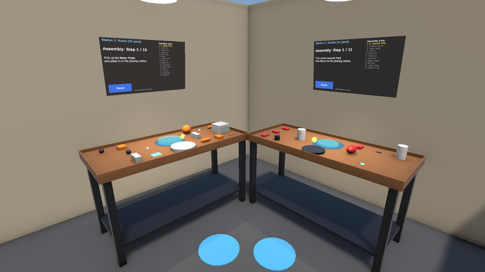
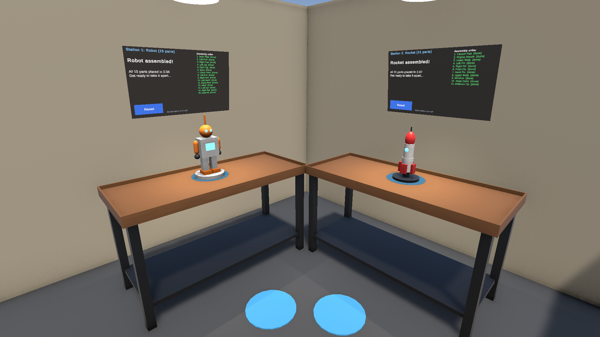
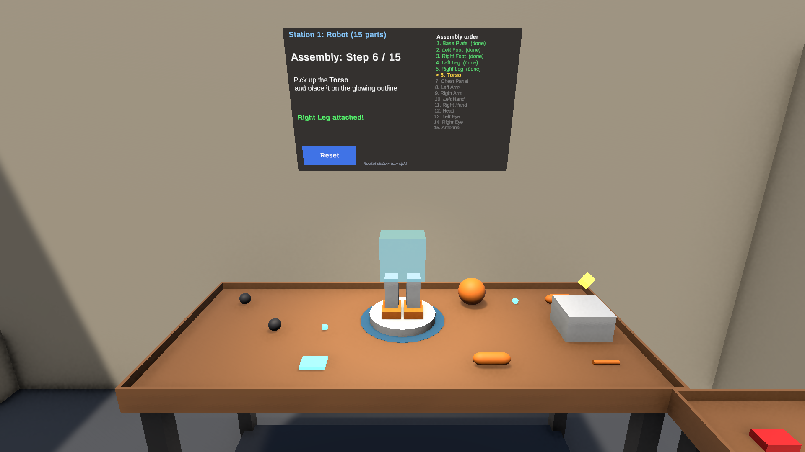
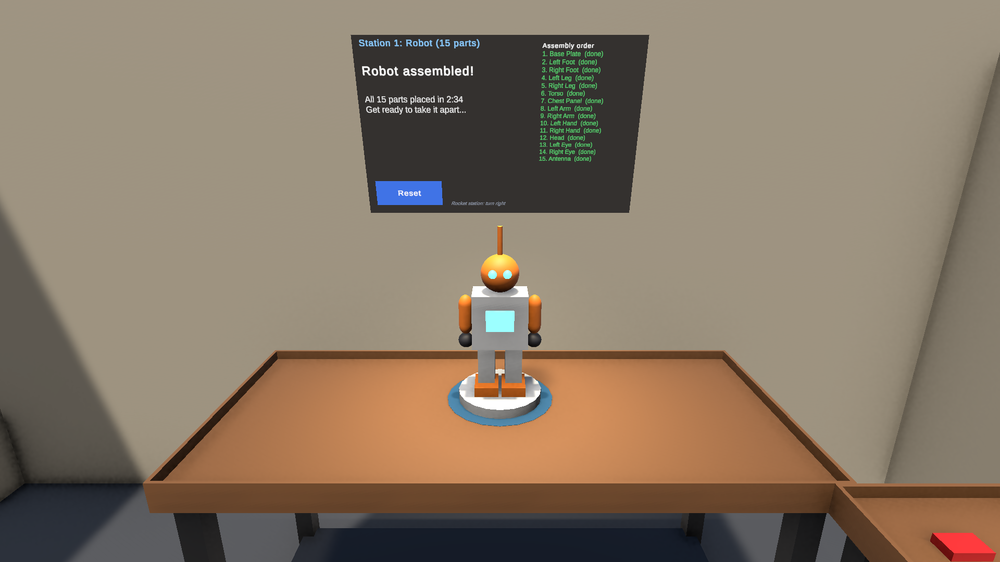
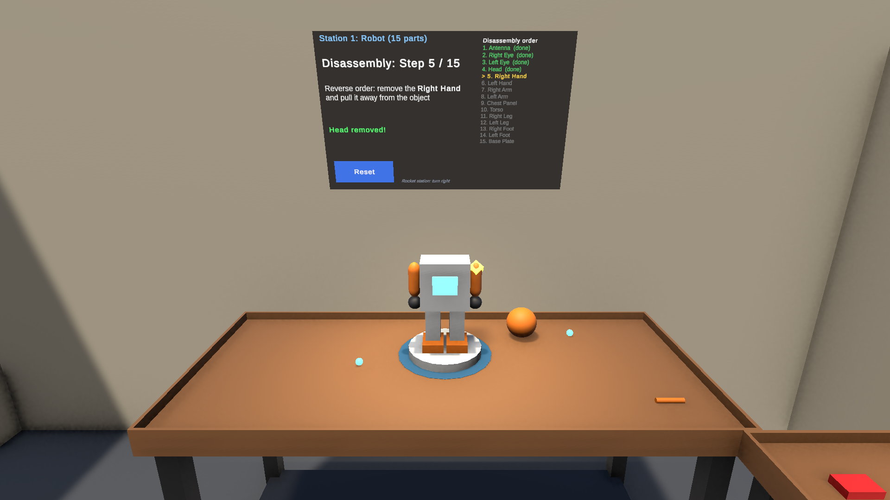
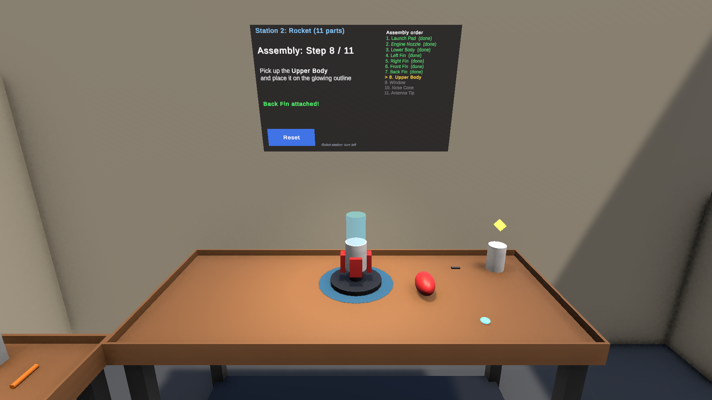
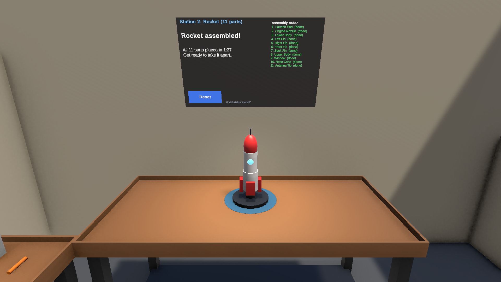

# CSC 461/592 – Assignment 3 VR Assembly

## Team
Efe Kaan Karaormanli and Ahmet Nejdet Begdes

## VR Assembly
The assembly object is a **15-part toy robot** built on a workbench in a small VR workshop. A second workbench next to it holds an **11-part toy rocket** (Bonus 3). The user stands in the corner between the two benches, grabs parts with the VR controllers and places them step by step in a fixed order. A glowing **ghost** shows exactly where the current part goes, a floating **marker** points at the part to pick up, and a **world-space panel** shows the current step, an instruction and the full checklist. When an object is finished it switches to **disassembly**, and the parts come off in reverse order (Bonus 2).

Built with Unity 6000.3.22f1 (URP), XR Interaction Toolkit 3.3.2 (Starter Assets XR Origin) and OpenXR. Tested target: Meta Quest 3 over Quest Link / Virtual Desktop on Windows.

| Start: both workstations | Both objects assembled |
|---|---|
|  |  |

### Implemented features (base requirements)

| Rubric item | Where / how |
|---|---|
| **VR-ready assembly scene** (lighting, environment, placement) | Workshop room (floor and 4 walls), two workbenches with legs, shelf and a rim so parts can't roll off. Lighting: a directional light with soft shadows, a spot work lamp over each bench and trilight ambient. Parts lie spread out on both sides of a blue **assembly pad** that marks the assembly area. XR Origin (XR Rig) from Starter Assets starts at headset height between the benches. |
| **Visual cues / UI in order** | **Ghost:** a transparent, pulsing copy of the current part sits at its exact final position and turns **green** when the held part is close enough to snap. **Marker:** a spinning yellow diamond floats over the part to grab, then over its slot while you hold it. **Panel:** "Assembly: Step N / M", an instruction ("Pick up the Torso and place it on the glowing outline"), and a checklist with done (green), current (yellow) and upcoming (grey) steps. **Feedback:** green "X attached!" or red "Not yet! First place the Y" text plus generated sounds (snap, error, fanfare). The panel also shows the completion time. |
| **Grab, manipulate, position with controllers** | Every part is an `XRGrabInteractable` (dynamic attach, physics). Grab with the **grip** button, rotate and move freely, and release near the slot. A part snaps only if it is **the current step**; it is then locked in place and can't be grabbed again until disassembly. Wrong-order parts dropped on the slot are rejected with feedback. |
| **At least 8 parts** | Robot: 15 parts. Rocket: 11 parts. |
| **GitHub repo + README** | This repository and README. Screenshots are in `Screenshots/`. |

| Robot: mid assembly (ghost of the Torso, marker over the Torso on the table) | Robot: completed |
|---|---|
|  |  |

### VR Assembly (Bonus 1: 15 parts)
The robot has **15 parts**, assembled in this order: Base Plate → Left Foot → Right Foot → Left Leg → Right Leg → Torso → Chest Panel → Left Arm → Right Arm → Left Hand → Right Hand → Head → Left Eye → Right Eye → Antenna. The table layout is shuffled, so where a part lies doesn't give away the order.

### VR Assembly (Bonus 2: Disassembly)
After the last part snaps in, the panel shows "Robot assembled! All 15 parts placed in m:ss" and, 3 seconds later, starts **disassembly in reverse order** (Antenna first, Base Plate last). Only the part that is due is unlocked; the marker hovers over it and the checklist switches to "Disassembly order". Grab it and pull it more than 20 cm away from its slot to remove it. If you let go too early, it snaps back into its slot. Removed parts become normal physics objects again. At the end the panel shows the assembly and disassembly times. Both objects support disassembly.

### VR Assembly (Bonus 3: Two assembly objects)
The second workstation, **on the user's right**, has an **11-part rocket**: Launch Pad → Engine Nozzle → Lower Body → Left Fin → Right Fin → Front Fin → Back Fin → Upper Body → Window → Nose Cone → Antenna Tip. It has its **own** `AssemblyManager`, instruction panel, ghosts, marker, reset button and disassembly. The two stations run independently, so you can switch between them at any time. Both benches are within reach by turning on the spot. The Starter Assets locomotion (thumbstick move and turn, and teleport onto the blue pads in front of each bench) also works.

| Rocket: mid assembly (ghost of the Upper Body) | Rocket: completed |
|---|---|
|  |  |

### Controls (Meta Quest 3 Touch Plus controllers)
- **Grip:** grab or release a part (works up close; the controller ray grabs from a distance)
- **Trigger on the panel:** press **Reset** to put every part of that station back on the table and restart at step 1
- **Left thumbstick:** move. **Right thumbstick:** turn, or push forward to teleport (aim at the blue pads)
- **Snapping:** release the highlighted part close to its ghost (within about 10 cm; any rotation is accepted). It snaps into the exact pose and locks.

### How to run
1. Open the project in **Unity 6000.3.22f1**, then open `Assets/VR Assembly/Scene_VRAssembly.unity` (it is also the first scene in Build Settings).
2. Connect the Quest 3 with **Quest Link** (cable or Air Link) or **Virtual Desktop**, and make sure the Meta Quest Link / VD app is the active OpenXR runtime.
3. Press **Play** and put on the headset. OpenXR initializes on startup with the Oculus Touch and Meta Quest Touch Plus controller profiles.
4. **No headset?** Run **Tools > VR Assembly > Toggle XR Device Simulator** to add the XR Device Simulator to the scene, then Play and use mouse and keyboard. Run the same menu item again to remove it before testing on the Quest.

### Project structure
- `Assets/VR Assembly/Scripts/AssemblyPart.cs`: grabbable part. Snaps to its target on release if it is its turn, builds its own ghost, and handles pull-out for disassembly.
- `Assets/VR Assembly/Scripts/AssemblyManager.cs`: step order, ghost, marker, panel text, checklist, feedback, sounds, timer, reverse-order disassembly and `ResetAssembly()`. One manager per object.
- `Assets/VR Assembly/Editor/VRAssemblySceneBuilder.cs`: **Tools > Build VR Assembly Scene**. Builds the whole scene from data: each assembly object is a list of parts (primitive, size, color, assembled position) plus the bench position. Adding a third object means adding one entry. It can also run headless: `Unity.exe -batchmode -quit -projectPath . -executeMethod VRAssemblySceneBuilder.BuildInBatch`.
- `Assets/VR Assembly/Editor/VRAssemblyScreenshots.cs`: **Tools > VR Assembly > Capture README Screenshots**. Renders the images above from a camera at headset height. Each shot is a staged state of the real scene, so the timer values shown in the screenshots are preview values.
